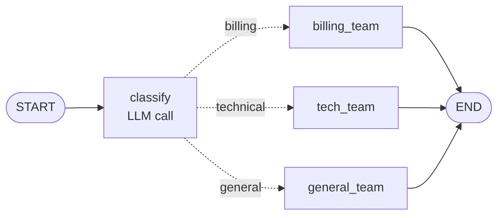

# מפרט: נתב פניות תמיכה עם LLM בתוך גרף LangGraph

צוות התמיכה של אפליקציית משימות קטנה מקבל עשרות פניות ביום דרך טופס עזרה, וכרגע מנתב אותן ידנית.
המערכת קוראת כל פנייה, נותנת למודל שפה להחליט לאיזה צוות היא שייכת (Billing, Tech או General), מעבירה אותה לצוות, ומחזירה ללקוח הודעה קצרה וקבועה שאומרת איזה צוות מטפל בה.
בנה אותה כגרף LangGraph במחברת Google Colab.

## אילוצים טכניים
- התקנה: `!pip -q install langgraph langchain-openai`
- **מפתח API מ־Colab Secrets בלבד**, בתא הראשון אחרי ההתקנה:
  ```python
  import os
  from google.colab import userdata
  os.environ["OPENAI_API_KEY"] = userdata.get("OPENAI_API_KEY")
  ```
  בלי `getpass`, ובלי שהמפתח יופיע בקוד, בפלט של תא כלשהו או במחברת.
- **קריאה אחת בלבד ל־LLM לכל פנייה**, בתוך ה־node `classify`.
- **קשת מותנית אחת בלבד** (`add_conditional_edges`). פונקציית הניתוב לא קוראת ל־LLM.
- בלי לולאות, בלי כלים ובלי זיכרון. בדיוק הגרף שבהמשך, ולא יותר.
- ציור הגרף עם `draw_mermaid_png()`.

## מודל
- `MODEL = "gpt-6-luna"`, מוגדר **פעם אחת** בראש המחברת, כדי שיהיה קל להחליף.
- `ChatOpenAI(model=MODEL, temperature=0)`.
- **למה המודל הזה:** סיווג פנייה לאחת משלוש קטגוריות הוא משימה קלה, ולא צריך בשבילה מודל גדול ויקר. `gpt-6-luna` הוא מהמודלים הזולים ביותר בדף התמחור של OpenAI, והשתמשתי בו כבר בתרגיל 1. `temperature=0` נותן תשובות עקביות ככל האפשר: אותה פנייה תגיע לאותו צוות בכל הרצה.

## ממשק
```python
result = graph.invoke({"ticket": "I was charged twice this month"})
```
כל תוצאה חייבת לכלול:

| מפתח | ערך |
|---|---|
| `ticket` | טקסט הפנייה המקורי |
| `category` | `"billing"`, `"technical"` או `"general"`, לפי בחירת ה־LLM |
| `team` | הצוות שאליו הועברה הפנייה |
| `reply` | הודעה קצרה ללקוח, טקסט קבוע לכל צוות (בלי LLM) |

## מבנה הגרף

### State
```python
class State(TypedDict):
    ticket: str      # the customer's message (input)
    category: str    # "billing" / "technical" / "general", chosen by the LLM
    team: str        # the team the ticket was forwarded to
    reply: str       # the fixed note sent to the customer
```

### Nodes
| Node | LLM? | תפקיד |
|---|---|---|
| `classify` | **כן** | שולח את `ticket` למודל ומחזיר רק `{"category": ...}` |
| `billing_team` | לא | `team = "Billing"` ותשובה קבועה |
| `tech_team` | לא | `team = "Tech"` ותשובה קבועה |
| `general_team` | לא | `team = "General"` ותשובה קבועה |

### קריאה ל־LLM ב־`classify`
- **Structured output:** מודל Pydantic קטן בשם `TicketCategory` עם שדה אחד, `category: Literal["billing", "technical", "general"]`. הקריאה נעשית דרך `ChatOpenAI(...).with_structured_output(TicketCategory)`. כך המודל יכול להחזיר רק אחד משלושת השמות, ואין צורך לפרסר טקסט חופשי.
- **ההודעות שנשלחות למודל:** `SystemMessage` עם ההוראה הבאה, ו־`HumanMessage` עם טקסט הפנייה.

  ```
  You route customer support tickets for TaskNest, a to-do app.
  Read the ticket and choose exactly one category:
  - billing: payments, charges, invoices, refunds, prices, subscriptions and plans.
  - technical: bugs, crashes, error messages, the app not working as it should, login and account access problems.
  - general: everything else, such as feature ideas, how-to questions, feedback and thank-you notes.
  Decide by the customer's main problem, not by single words.
  If something is broken or shows an error, choose technical, even when it happens while paying.
  ```

- בתוך `classify`, מעל השורה שבה המודל נקרא, הערה: `# <-- THE LLM CALL`.

### Edges וקשת מותנית
- קשתות קבועות: `START → classify`, `billing_team → END`, `tech_team → END`, `general_team → END`.
- **קשת מותנית אחת** מ־`classify`: פונקציית הניתוב `route(state) -> Literal["billing", "technical", "general"]` מחזירה רק את `state["category"]`. מעליה הערה: `# <-- THE LLM'S ANSWER CHOOSES THE EDGE`.
- `add_conditional_edges("classify", route, {"billing": "billing_team", "technical": "tech_team", "general": "general_team"})`. המיפוי מחבר כל קטגוריה ל־node של הצוות, וגם מציג את שם הקטגוריה על הקשת בציור.



## תשובות קבועות ללקוח
| צוות | `team` | `reply` |
|---|---|---|
| billing | `Billing` | Thanks for reaching out! Your ticket is now with our Billing team. They'll get back to you within one business day. |
| technical | `Tech` | Thanks for reaching out! Your ticket is now with our Tech team. They'll look into the problem and get back to you soon. |
| general | `General` | Thanks for reaching out! Your ticket is now with our General support team. We'll get back to you soon. |

## בדיקות במחברת
- הרצה של הדוגמה מסעיף "ממשק", והדפסה של ארבעת המפתחות.
- הרצה של כל הפניות בטבלה. לכל פנייה מדפיסים את `ticket`, `category` ו־`reply`.
- `assert` שכל ארבעת המפתחות קיימים, ש־`category` הוא אחד משלושת הערכים, ושה־`team` וה־`reply` תואמים לקטגוריה.
- **לא** עושים `assert` על הקטגוריה הצפויה, כי ההחלטה היא של המודל. במקום זה, טבלת סיכום (pandas) עם עמודות: הפנייה, הקטגוריה הצפויה, הקטגוריה שהמודל בחר, והאם הן תואמות.

| # | סוג | ticket | צפוי |
|---|---|---|---|
| 1 | billing | I was charged twice this month | billing |
| 2 | billing | How do I get a refund for my annual subscription? | billing |
| 3 | technical | The app crashes whenever I open a list with more than 100 tasks | technical |
| 4 | technical | I can't log in. It says "invalid token" even after I reset my password | technical |
| 5 | general | It would be great if I could color-code my tasks | general |
| 6 | general | Just wanted to say thanks, TaskNest keeps my whole week organized! | general |
| 7 | עמומה | The app crashes every time I try to pay | technical |
| 8 | עמומה | I paid for Premium but the Premium features still don't show up in the app | technical |
| 9 | עמומה | Do you have a student discount? | billing |
| 10 | עמומה | Thanks for fixing the login bug last week! Any plans for a dark mode? | general |
